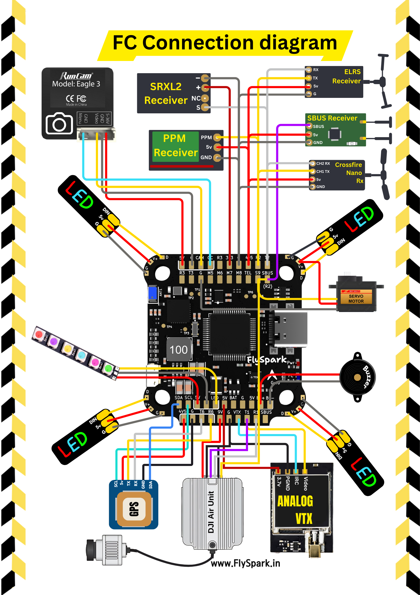
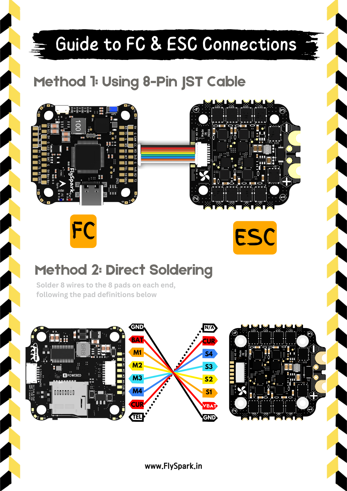

# 🟨 FlySpark F4 V1 Flight Controller

**STM32F405 flight controller with built-in Bluetooth, OSD, SD blackbox and 8 motor outputs.**
Runs **Betaflight**, **INAV** and **ArduPilot** (Mission Planner / QGroundControl).

[💾 Firmware downloads](firmware) · [🛒 Buy FC](https://flyspark.in/products/flyspark-f4-v1-flight-controller) · [🛒 Buy stack](https://flyspark.in/products/flyspark-f4-v1-bls-60a-stack-flight-controller-4-in-1-esc) · [⬅️ All FCs](../README.md)

---

## ✨ Highlights

| | |
|---|---|
| 🧠 **MCU** | STM32F405RGT6 · 168 MHz · 1 MB flash |
| 🎯 **Gyro / Acc** | ICM-42688-P (SPI1) |
| 🌡️ **Barometer** | DPS310 (I²C1, address 0x76) |
| 📺 **OSD** | MAX7456 analog OSD (SPI2) + DJI / HD DisplayPort on UART1 |
| 💾 **Blackbox** | microSD slot (SPI3) |
| 📶 **Bluetooth** | Built-in ESP32-C3 BLE bridge on UART4 · configure from your phone · works with Betaflight, INAV and ArduPilot |
| 🔋 **Battery gauge** | 4 LEDs show pack level, voltage sensing 10k/1k divider (scale 11.0) |
| 🔌 **Outputs** | 8 motor outputs (M1–M8) · LED strip · buzzer · camera control |
| 🔁 **UARTs** | 6 hardware UARTs (UART4 reserved for Bluetooth) · SBUS input with hardware inverter |
| ⚡ **Power** | 3–6S LiPo input · 5 V 3 A BEC · 9 V 3 A BEC (VTX / camera) · 3.3 V · 4.5 V (USB powered) |
| 🔗 **USB** | USB-C · BOOT button for DFU |
| 📐 **Mounting** | 30.5 × 30.5 mm (Ø4 mm holes, M3 grommets) |

---

## 🗺️ Wiring Diagrams

<table>
<tr>
<td width="50%"></td>
<td width="50%"></td>
</tr>
<tr>
<td align="center">📡 Receivers · GPS · VTX · DJI · LED · buzzer</td>
<td align="center">🔌 FC ↔ ESC 8-pin harness / direct solder</td>
</tr>
</table>

---

## 📍 Pinout & Port Map

### 🔁 UARTs

| UART | Pads | 🟡 Betaflight default | 🔵 INAV default | 🟢 ArduPilot (SERIALn) |
|---|---|---|---|---|
| **UART1** | TX1 / RX1 + DJI 6-pin plug | free (set *MSP DisplayPort* for DJI/HD) | free | SERIAL1 · MSP DisplayPort |
| **UART2** | RX2 · **SBUS** (inverted) · TX2 | **Serial RX** | **Serial RX (SBUS)** | SERIAL2 · RC input |
| **UART3** | TX3 / RX3 | free | free | SERIAL3 · free |
| **UART4** | — internal | 📶 **Bluetooth MSP 115200** | 📶 **Bluetooth MSP 115200** | SERIAL4 · 📶 **MAVLink2 115200** |
| **UART5** | TEL (RX only) | ESC telemetry | ESC telemetry | SERIAL5 · ESC telemetry |
| **UART6** | TX6 / RX6 | free (GPS) | free (GPS) | SERIAL6 · **GPS** |

> 📡 **SBUS**: solder to the **SBUS** pad (or use the DJI plug) — it goes through an on-board inverter into UART2 RX.
> **CRSF / ELRS / GHST**: use **TX2 / RX2**. Do not connect SBUS and RX2 at the same time.

### 🔩 Motors & timers

| Output | M1 | M2 | M3 | M4 | M5 | M6 | M7 | M8 | LED |
|---|---|---|---|---|---|---|---|---|---|
| **Pin** | PB6 | PB7 | PB0 | PB1 | PC8 | PC9 | PB10 | PA15 | PA8 |
| **Timer** | TIM4 | TIM4 | TIM3 | TIM3 | TIM8 | TIM8 | TIM2 | TIM2 | TIM1 |

> ⚠️ Outputs on the **same timer** must use the same protocol/rate (e.g. M5+M6). Plan servos and motors in pairs on INAV / ArduPilot planes.

### 🧩 Other I/O

| Function | Pin | Notes |
|---|---|---|
| Battery voltage | PC0 | 10k / 1k divider · scale **110** (BF/INAV) · **11.0** (ArduPilot) |
| Current sensor | PC1 | `CURRENT` pad for an external sensor (the BLS 60A ESC has none) |
| RSSI (analog) | PC5 | `RS` pad |
| Buzzer | PC15 | `BZ+ / BZ-` pads, 5 V active buzzer |
| Status LED | PC13 | blue FC LED |
| LED strip | PA8 | WS2812, `LED` pad |
| Camera control | PB14 | `CC` pad |
| PPM / PWM in | PB15 | `S9` pad |
| I²C1 | PB8 SCL / PB9 SDA | compass, rangefinder, airspeed |

---

## 🔌 Stack: FlySpark F4 V1 + BLS 60A

The FC plugs into the **[FlySpark BLS 60A 4-in-1 ESC](../../ESC/FlySpark-BLS-60A)** with the 8-pin JST harness.

| FC J3 pin | 1 | 2 | 3 | 4 | 5 | 6 | 7 | 8 |
|---|---|---|---|---|---|---|---|---|
| **Signal** | TEL | CURRENT | M4 | M3 | M2 | M1 | VBAT | GND |

- ✅ ESC firmware: **BLHeli_S J_H_40 16.7** → use **DShot300** (or DShot600), **bidirectional DShot OFF**.
- ✅ The 60A ESC has **no current sensor** → current meter is **OFF** in all FlySpark firmware builds.
- ⚡ Max battery: **6S**.

---

## 💾 Firmware

| | Version | File | Flash with |
|---|---|---|---|
| 🟡 [**Betaflight**](firmware/betaflight) | 2026.6.2 | `betaflight_2026.6.2_FLYSPARKF4.hex` | Betaflight App / Configurator |
| 🔵 [**INAV**](firmware/inav) | 9.1.0 | `inav_9.1.0_FlySparkF4v1.hex` | INAV Configurator |
| 🟢 [**ArduCopter**](firmware/ardupilot) | 4.7.1 | `arducopter_4.7.1_FlysparkF4.apj` | Mission Planner / QGC |
| 🟢 [**ArduPlane**](firmware/ardupilot) | 4.7.1 | `arduplane_4.7.1_FlysparkF4.apj` | Mission Planner / QGC |
| 📶 [**Bluetooth bridge**](firmware/bluetooth) | V12 | `FlySpark_BLE_V12.bin` | esptool / ESP Flash Tool |

👉 **[Open the firmware page](firmware)** for step-by-step flashing guides and checksums.

---

## 📶 Bluetooth

- Phone/tablet name: **`FlySpark F4 v2`** · HM-10 / CC2541 style serial (service `FFE0`, characteristic `FFE1`).
- 🟡🔵 Betaflight / INAV: MSP — connect with the **FlySpark app**, Betaflight App or SpeedyBee app (Bluetooth → CC2541).
- 🟢 ArduPilot: MAVLink2 at 115200 on UART4 (FlySpark builds enable it by default).
- 🔋 The 4 battery LEDs work with **all three** firmwares (MSP battery state or MAVLink `SYS_STATUS`).
- 💡 All 4 LEDs blinking = the STM32 is not running flight firmware (empty or in DFU).

---

## ✅ First Setup Checklist

1. Flash the firmware you want ([firmware page](firmware)).
2. Check the **board orientation**: tilt the board in the configurator — the 3D model / horizon must follow.
3. Check the battery voltage reads correctly (± 0.1 V of a multimeter).
4. Set your receiver port (UART2 by default) and protocol.
5. Props **off**: test every motor and direction.
6. Calibrate the accelerometer, set modes / failsafe, then fly. 🚁

---

## 🛟 Help

[🐞 Open a support issue](https://github.com/flyspark015/FlySpark/issues/new/choose) · [💬 WhatsApp +91 63757 29997](https://wa.me/916375729997) · [✉️ info@flyspark.in](mailto:info@flyspark.in) · [🌐 flyspark.in](https://flyspark.in)
