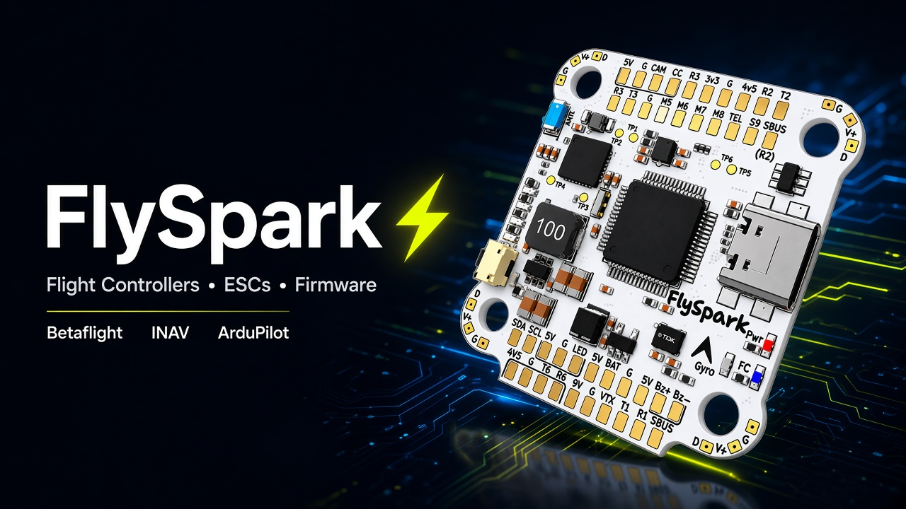
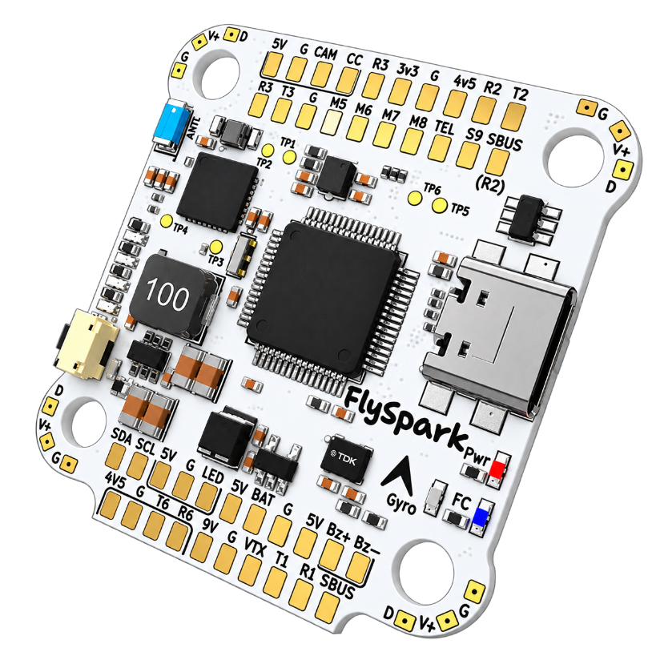

<div align="center">



# ⚡ FlySpark Hardware

**Official home of FlySpark flight controllers, ESCs, firmware, wiring diagrams and support.**

[](https://flyspark.in)
[](https://wa.me/916375729997)
[](mailto:info@flyspark.in)

[](FC/FlySpark-F4-V1/firmware/betaflight)
[](FC/FlySpark-F4-V1/firmware/inav)
[](FC/FlySpark-F4-V1/firmware/ardupilot)
[](FC/FlySpark-F4-V1/firmware/ardupilot)
[](FC/FlySpark-F4-V1/firmware/bluetooth)

</div>

---

## 🚀 Quick Downloads

> Pick your board, then your firmware. Every link opens the page with the file, the flashing guide and the checksums.

| 🧠 Board | 🟡 Betaflight | 🔵 INAV | 🟢 ArduPilot (Mission Planner) | 📶 Bluetooth |
|---|:---:|:---:|:---:|:---:|
| **[FlySpark F4 V1](FC/FlySpark-F4-V1)** | [**2026.6.2** ⬇️](FC/FlySpark-F4-V1/firmware/betaflight) | [**9.1.0** ⬇️](FC/FlySpark-F4-V1/firmware/inav) | [**Copter / Plane 4.7.1** ⬇️](FC/FlySpark-F4-V1/firmware/ardupilot) | [**V12** ⬇️](FC/FlySpark-F4-V1/firmware/bluetooth) |
| **[FlySpark H743 Pro](FC/FlySpark-H743-Pro)** | 🔜 soon | 🔜 soon | 🔜 soon | — |

📦 **All firmware for the F4 in one place:** [FC/FlySpark-F4-V1/firmware](FC/FlySpark-F4-V1/firmware)

---

## 🛩️ Products

<table>
<tr>
<td width="50%" valign="top">

### 🟨 [FlySpark F4 V1 Flight Controller](FC/FlySpark-F4-V1)

<a href="FC/FlySpark-F4-V1"></a>

- STM32F405 · ICM-42688-P · DPS310 baro
- MAX7456 OSD · microSD blackbox
- **Built-in Bluetooth** + 4-LED battery gauge
- 8 motor outputs · 6 UARTs · 5 V / 9 V BEC
- Betaflight · INAV · ArduPilot

[📘 Manual & pinout](FC/FlySpark-F4-V1) · [💾 Firmware](FC/FlySpark-F4-V1/firmware) · [🛒 Buy](https://flyspark.in/products/flyspark-f4-v1-flight-controller)

</td>
<td width="50%" valign="top">

### 🟦 [FlySpark H743 Pro Flight Controller](FC/FlySpark-H743-Pro)

- STM32H743 @ 480 MHz
- Dual ICM-42688 IMUs · SPL06 baro
- 4–12S · 5 V / 12 V 3 A rails
- Up to 8 UARTs · CAN · dual camera
- For X8 cinelifters, long range, VTOL

[📘 Product page](FC/FlySpark-H743-Pro) · [🌐 flyspark.in](https://flyspark.in)

</td>
</tr>
<tr>
<td width="50%" valign="top">

### 🔌 [FlySpark F4 V1 + BLS 60A Stack](FC/FlySpark-F4-V1)

FC + 60A 4-in-1 ESC on one 30.5 mm stack, plug-and-play 8-pin harness.

[📘 Stack guide](FC/FlySpark-F4-V1#-stack-flyspark-f4-v1--bls-60a) · [🛒 Buy](https://flyspark.in/products/flyspark-f4-v1-bls-60a-stack-flight-controller-4-in-1-esc)

</td>
<td width="50%" valign="top">

### ⚙️ [FlySpark BLS 60A 4-in-1 ESC](ESC/FlySpark-BLS-60A)

BLHeli_S J_H_40 16.7 · 60 A continuous / 80 A burst · 3–6S · DShot 150/300/600

[📘 ESC guide](ESC/FlySpark-BLS-60A) · [🛒 Buy](https://flyspark.in/products/flyspark-bls-60a-4-in-1-esc)

</td>
</tr>
</table>

---

## 🧭 Which firmware should I use?

| You want… | Use | Configure with |
|---|---|---|
| 🏁 Freestyle / racing / cinematic FPV | 🟡 **Betaflight** | Betaflight App / Configurator, SpeedyBee app, FlySpark app (Bluetooth) |
| 🛰️ GPS rescue, position hold, waypoints, wings | 🔵 **INAV** | INAV Configurator, FlySpark app (Bluetooth) |
| 🗺️ Autonomous missions, survey, mapping, planes, VTOL | 🟢 **ArduPilot** | Mission Planner, QGroundControl |

You can switch at any time — every firmware page explains how to flash and how to go back.

---

## 📁 Repository Map

```text
FlySpark/
├── FC/
│   ├── FlySpark-F4-V1/          📘 manual, pinout, wiring, stack guide
│   │   ├── images/              🖼️ board photos + wiring diagrams
│   │   └── firmware/
│   │       ├── betaflight/      🟡 .hex + config.h + CLI defaults
│   │       ├── inav/            🔵 .hex + source patch
│   │       ├── ardupilot/       🟢 .apj (Mission Planner) + _with_bl.hex
│   │       └── bluetooth/       📶 ESP32-C3 BLE bridge firmware
│   └── FlySpark-H743-Pro/       📘 product page
├── ESC/
│   └── FlySpark-BLS-60A/        ⚙️ BLHeli_S firmware + settings
└── SUPPORT.md                   🛟 how to get help
```

---

## 🛟 Support

| | |
|---|---|
| 🐞 **Bug or flashing problem** | [Open a support issue](https://github.com/flyspark015/FlySpark/issues/new/choose) — attach your firmware version and a screenshot |
| 💬 **WhatsApp** | [+91 63757 29997](https://wa.me/916375729997) |
| ✉️ **Email** | [info@flyspark.in](mailto:info@flyspark.in) |
| 🌐 **Website / orders** | [flyspark.in](https://flyspark.in) · [Contact](https://flyspark.in/contact) |
| 🔗 **Social** | [LinkedIn](https://linkedin.com/company/flyspark) · [Facebook](https://facebook.com/flyspark) · [X / Twitter](https://twitter.com/flyspark) |

More in **[SUPPORT.md](SUPPORT.md)**.

---

<div align="center">

**⚡ FlySpark — Made for pilots who build.**

<sub>Betaflight, INAV and ArduPilot are open-source projects licensed under GPL-3.0. FlySpark builds are made from the official
release tags; our small default-setting changes are published next to each binary as <code>.patch</code> files.</sub>

</div>
